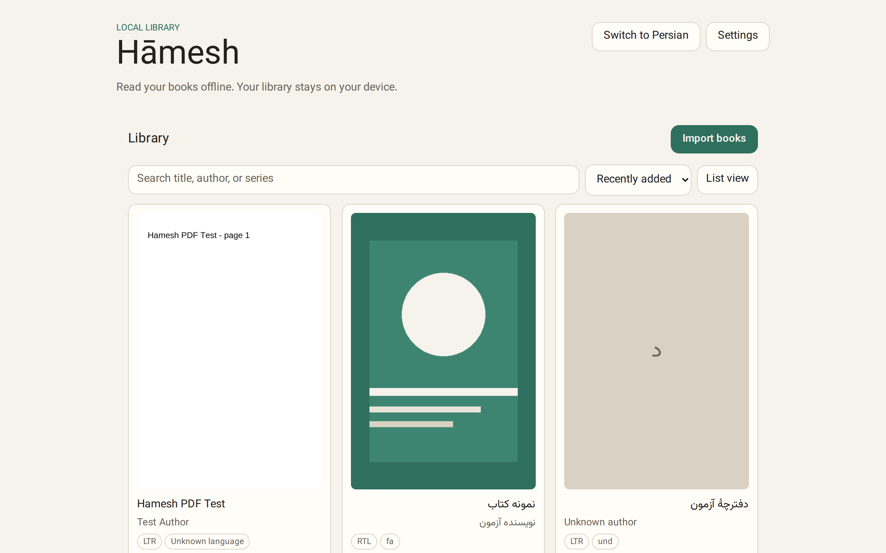
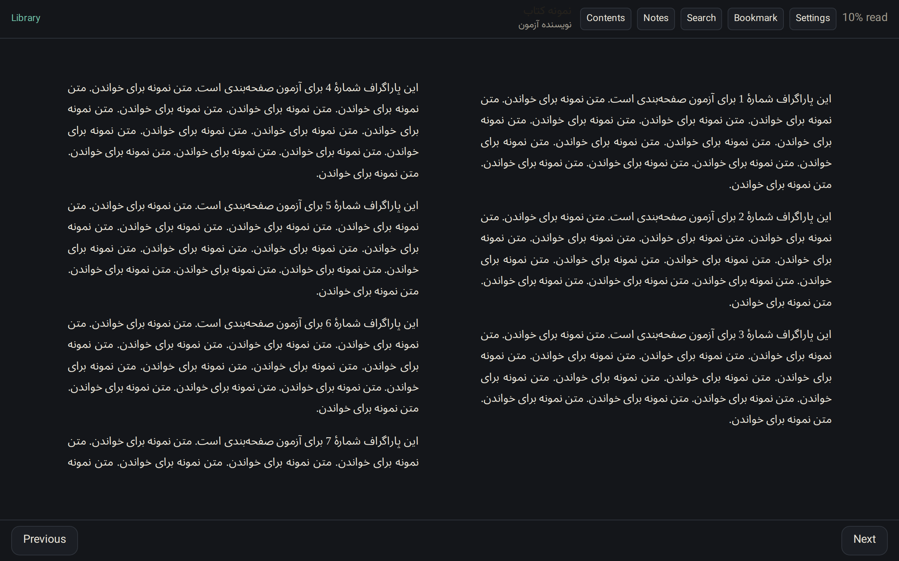

# Hāmesh

Hāmesh (هامش) is a local-first, cross-platform ebook reader with first-class
RTL support and sync to storage you own. No accounts, no vendor backend.

<p align="center">
  
  
</p>

The screenshots refresh automatically with every release.

## What works

- EPUB and PDF import with SHA-256 identity, metadata, covers, and duplicate
  detection.
- Library search and content search, sort, grid/list views, and persisted
  reading progress.
- Paginated and scrolled EPUB reading, TOC, font size, themes, justification,
  and direction-aware navigation for Persian/Arabic and English books.
- PDF opening, page navigation, zoom, and saved page position.
- Highlights, bookmarks, notes, Markdown/JSON export, and in-book search.
- Settings dialog with system/light/dark appearance, language (English/Persian),
  updates, and keyboard shortcuts; preferences stay local.
- Sync between devices through storage you own: WebDAV, a local folder, or
  S3-compatible storage, with per-field last-writer-wins and tombstones.
- EPUB sanitization and a restrictive content CSP.
- SQLite persistence on desktop and web, with a one-time JSON import.
- Desktop shell with open-with and `.epub`/`.pdf` file associations; Linux
  (deb/rpm/AppImage) and Windows installers from CI.

## Requirements

- Node.js 22+
- pnpm 12 (or corepack)
- Rust + Cargo and WebKitGTK (Linux) or WebView2 (Windows) for the desktop shell

## Commands

```bash
git submodule update --init --recursive
pnpm install
pnpm dev        # web shell
pnpm tauri:dev  # desktop shell
pnpm test
pnpm test:e2e
pnpm lint       # biome + typecheck + boundary + logical-property checks
pnpm build
pnpm tauri:build
```

## Development workflow

`main` is protected: open a branch and a pull request instead of pushing to
`main` directly. CI runs lint, unit tests, the web build, the Playwright suite,
and a Windows desktop check on every pull request.

Releases are automatic. The squash commit subject (the PR title) drives the
version: `feat:` bumps minor, `fix:`/`perf:`/`refactor:` bumps patch,
`!:` or `BREAKING CHANGE` bumps major, and `docs:`/`ci:`/`chore:` merges do
not release. A merge creates the tag and publishes the installers immediately.
